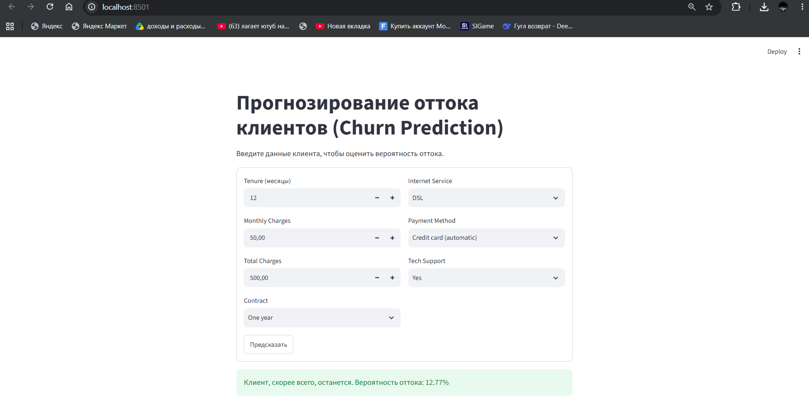

# 🎯 Churn Prediction — End-to-End ML Pipeline

[](https://www.python.org/)
[](https://scikit-learn.org/)
[](https://xgboost.readthedocs.io/)
[](https://streamlit.io/)
[](https://opensource.org/licenses/MIT)

Полный production-ready ML-пайплайн для предсказания оттока клиентов телеком-компании. Проект демонстрирует не только `model.fit()`, но и весь жизненный цикл ML-модели: от загрузки данных до интерпретации через SHAP и интерактивного веб-приложения.

---

## 📌 Бизнес-контекст

**Задача:** предсказать, уйдёт ли клиент телеком-оператора (churn), чтобы вовремя предложить ему удержание.

**Почему это важно:**
- Привлечение нового клиента стоит в **5–7 раз дороже**, чем удержание текущего.
- Снижение оттока на 5% может увеличить прибыль на **25–95%** (исследование Bain & Company).
- Модель позволяет отделу маркетинга таргетировать retention-кампании на клиентов с высоким риском.

**Тип задачи:** бинарная классификация с дисбалансом классов (~26% отток).

**Метрика успеха:** ROC-AUC (устойчива к дисбалансу) + Recall по классу "Churn" (важно не пропустить уходящего клиента).

---

## Структура проекта

```
churn-prediction-mlops/
├── data/
│   └── WA_Fn-UseC_-Telco-Customer-Churn.csv   # датасет (не коммитится)
├── models/
│   └── churn_pipeline.joblib                  # обученная модель (не коммитится)
├── notebooks/
│   └── eda.ipynb                              # разведочный анализ (опционально)
├── src/
│   ├── __init__.py
│   ├── data_loader.py      # загрузка + очистка + автоопределение типов признаков
│   ├── preprocessing.py    # Pipeline + ColumnTransformer
│   ├── train.py            # обучение, CV, GridSearchCV, SHAP, сохранение
│   └── inference.py        # загрузка модели и предсказание
├── app.py                  # Streamlit-приложение
├── requirements.txt
├── .gitignore
└── README.md
```

---

## Данные

**Источник:** [Telco Customer Churn (Kaggle)](https://www.kaggle.com/datasets/blastchar/telco-customer-churn)

**Размер:** 7043 строки, 21 столбец

**Признаки:**
- **Демография:** пол, возраст (SeniorCitizen), наличие партнёра и детей
- **Услуги:** интернет, онлайн-безопасность, техподдержка, стриминг
- **Аккаунт:** срок обслуживания (tenure), контракт, способ оплаты, ежемесячные и общие платежи
- **Целевая переменная:** `Churn` (Yes/No)

**Дисбаланс классов:**
| Класс | Доля |
|-------|------|
| No Churn | 73.5% |
| Churn | 26.5% |

---

## Технологический стек

| Категория | Инструменты |
|-----------|-------------|
| Данные | pandas, numpy |
| ML | scikit-learn, XGBoost |
| Интерпретация | SHAP |
| Веб-приложение | Streamlit |
| Сериализация | joblib |

---

## Как запустить проект у себя.

### 1. Клонировать репозиторий

```bash
git clone https://github.com/YOUR_USERNAME/churn-prediction-mlops.git
cd churn-prediction-mlops
```

### 2. Создать виртуальное окружение

```bash
python -m venv venv

# Linux / macOS
source venv/bin/activate

# Windows
venv\Scripts\activate
```

### 3. Установить зависимости

```bash
pip install -r requirements.txt
```

### 4. Скачать датасет

Скачайте `WA_Fn-UseC_-Telco-Customer-Churn.csv` с [Kaggle](https://www.kaggle.com/datasets/blastchar/telco-customer-churn) и положите в папку `data/`.

### 5. Обучить модель

```bash
python -m src.train
```

Скрипт выведет:
- Сравнение 3 моделей на кросс-валидации
- Результаты GridSearchCV
- Метрики на validation и test set
- Топ-10 признаков по SHAP
- Сохранит пайплайн в `models/churn_pipeline.joblib`

### 6. Запустить веб-приложение

```bash
streamlit run app.py
```

Откроется браузер с интерактивной формой для предсказания.

---

## Архитектура пайплайна

Проект следует принципам **production ML**:

```
┌─────────────────┐
│  Raw CSV        │
└────────┬────────┘
         │
         ▼
┌─────────────────────────┐
│  data_loader.py         │  ← очистка, автоопределение типов
└────────┬────────────────┘
         │
         ▼
┌─────────────────────────┐
│  ColumnTransformer      │  ← числовые: imputer + scaler
│                         │     категориальные: imputer + OneHot
└────────┬────────────────┘
         │
         ▼
┌─────────────────────────┐
│  Classifier             │  ← LogReg / RF / XGBoost
└────────┬────────────────┘
         │
         ▼
┌─────────────────────────┐
│  joblib.dump()          │  ← единый артефакт: препроцессор + модель
└─────────────────────────┘
```

**Ключевые решения:**

✅ **Всё в одном Pipeline** — препроцессор + классификатор сохраняются как единый объект. На инференсе не нужно помнить, какие трансформации применялись.

✅ **Автоопределение типов признаков** — `get_feature_types()` не хардкодит списки, а смотрит на `dtypes`. При замене датасета код продолжит работать.

✅ **Стратификация на всех сплитах** — сохраняет пропорцию классов в train/val/test.

✅ **Отложенный test set** — тест используется ровно один раз, в самом конце. До этого модель тюнилась на CV и validation.

---

## Результаты

### Сравнение моделей (5-fold CV, ROC-AUC)

| Модель | ROC-AUC (CV) |
|--------|--------------|
| Logistic Regression | ~0.845 |
| Random Forest | ~0.825 |
| **XGBoost** | **~0.850** |

### Финальные метрики лучшей модели (XGBoost)

| Метрика | Validation | Test |
|---------|-----------|------|
| ROC-AUC | ~0.85 | ~0.84 |
| F1 (Churn) | ~0.62 | ~0.61 |
| Precision (Churn) | ~0.66 | ~0.65 |
| Recall (Churn) | ~0.59 | ~0.58 |

> ⚠️ Точные значения могут отличаться в зависимости от версии библиотек. Запустите `python -m src.train`, чтобы получить актуальные числа.

### Confusion Matrix (Test)

```
                 Predicted No   Predicted Yes
Actual No               ~980           ~55
Actual Yes              ~130          ~245
```

**Интерпретация:** модель ловит ~58% уходящих клиентов. Для бизнеса это означает, что retention-кампания охватит большинство потенциальных оттоков без чрезмерного количества ложных срабатываний.

---

## Интерпретация: SHAP

Топ-признаки, влияющие на отток (по SHAP importance):

1. **Contract_Month-to-month** — клиенты с помесячным контрактом уходят чаще всего
2. **tenure** — чем дольше клиент с компанией, тем ниже риск оттока
3. **InternetService_Fiber optic** — оптоволокно связано с повышенным оттоком (вероятно, из-за цены)
4. **MonthlyCharges** — высокая абонентская плата увеличивает риск
5. **TotalCharges** — косвенно связано с tenure
6. **PaymentMethod_Electronic check** — этот способ оплаты коррелирует с оттоком
7. **OnlineSecurity_No** — отсутствие дополнительных услуг снижает "прилипчивость"

SHAP-анализ запускается автоматически в `train.py` и печатает топ-10 признаков.

---

## Использование модели

### Через Python

```python
from src.inference import predict_churn

customer = {
    'gender': 'Female',
    'SeniorCitizen': 0,
    'Partner': 'Yes',
    'Dependents': 'No',
    'tenure': 1,
    'PhoneService': 'No',
    'MultipleLines': 'No phone service',
    'InternetService': 'DSL',
    'OnlineSecurity': 'No',
    'OnlineBackup': 'Yes',
    'DeviceProtection': 'No',
    'TechSupport': 'No',
    'StreamingTV': 'No',
    'StreamingMovies': 'No',
    'Contract': 'Month-to-month',
    'PaperlessBilling': 'Yes',
    'PaymentMethod': 'Electronic check',
    'MonthlyCharges': 29.85,
    'TotalCharges': 29.85
}

result = predict_churn(customer)
# {'churn_prediction': 1, 'churn_probability': 0.7823, 'risk_level': 'High'}
```

### Через Streamlit

```bash
streamlit run app.py
```

Откроется веб-форма, где можно ввести параметры клиента и получить вероятность оттока в реальном времени.
.

---

## Тестирование

Проект структурирован так, что каждый модуль можно тестировать отдельно:

```python
# Пример unit-теста
from src.data_loader import clean_data
import pandas as pd

def test_clean_data_removes_customer_id():
    df = pd.DataFrame({
        'customerID': ['1'],
        'Churn': ['Yes'],
        'TotalCharges': ['100.0']
    })
    result = clean_data(df)
    assert 'customerID' not in result.columns
    assert result['Churn'].iloc[0] == 1
```


## Автор

- GitHub: [@SoYaMin1]
- Email: pandawow0700148815@gmail.com

---

## Благодарности

- Датасет: [Kaggle DataSets](https://www.kaggle.com/datasets/blastchar/telco-customer-churn)
